# Yuuki AI 能力测试

记录各模型的基准测试结果。日期均为 `Asia/Shanghai (UTC+08:00)`。

> **`agy` 正常使用参考条件（仅基于个人实测案例）**：保证网络不处于受限/低数据模式（如 macOS 连 iPhone 热点时关闭「低数据模式」消除 `constrained` 标记），并配合屏蔽 QUIC、关闭自动断连的固定稳定代理节点，确保 60s+ 静默 TCP 长流不被掐断（详见 [`docs/agy-issues.md`](./docs/agy-issues.md)）。

## 鹈鹕骑自行车（SVG）

所有 SVG 位于 [`samples/`](./samples/)，复测流程见 [`skills/pelican-test/SKILL.md`](./skills/pelican-test/SKILL.md)（支持 `/pelican-test static` 与 `/pelican-test anim`）。

<strong>GPT 静态样本（8 项：2026-10-27 ~ 2026-11-18）</strong>

| 生成日期 | SVG 预览 | 调用入口 | 模型 | 推理强度 | 原始提示词 |
| --- | --- | --- | --- | --- | --- |
| 2026-10-27 | <a href="./samples/pelican-bicycle.svg">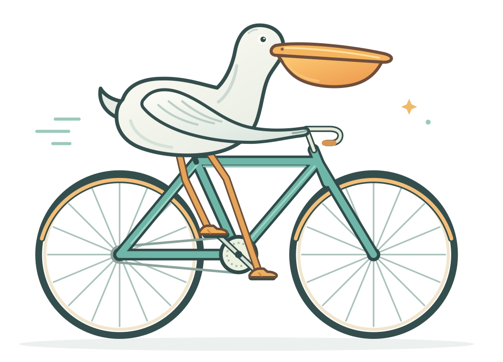</a> | Codex | `gpt-6.1-terra` | `max` | 画一个鹈鹕自行车svg |
| 2026-10-31 |  | Codex | `gpt-6.1-sol` | `max` | 使用 svg 绘制一次鹈鹕自行车，写入当前的日期然后 $push |
| 2026-11-02 | <a href="./samples/pelican-bicycle-2026-11-02.svg">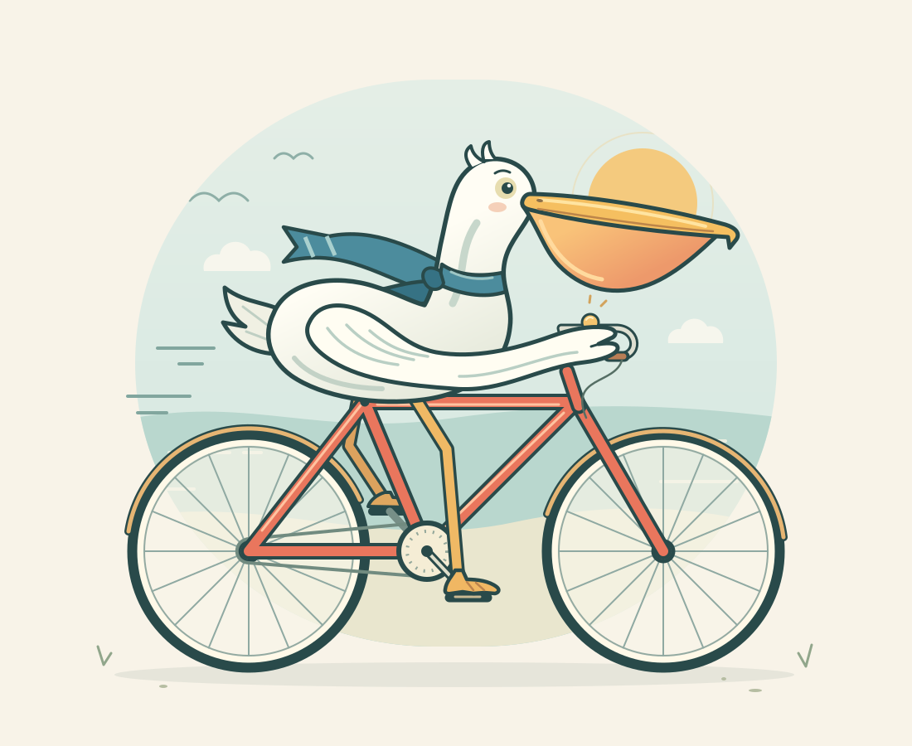</a> | Codex | `gpt-6-astra` | `max` | 用 svg 绘制一个鹈鹕骑自行车 |
| 2026-11-14 | <a href="./samples/pelican-bicycle-2026-11-14.svg">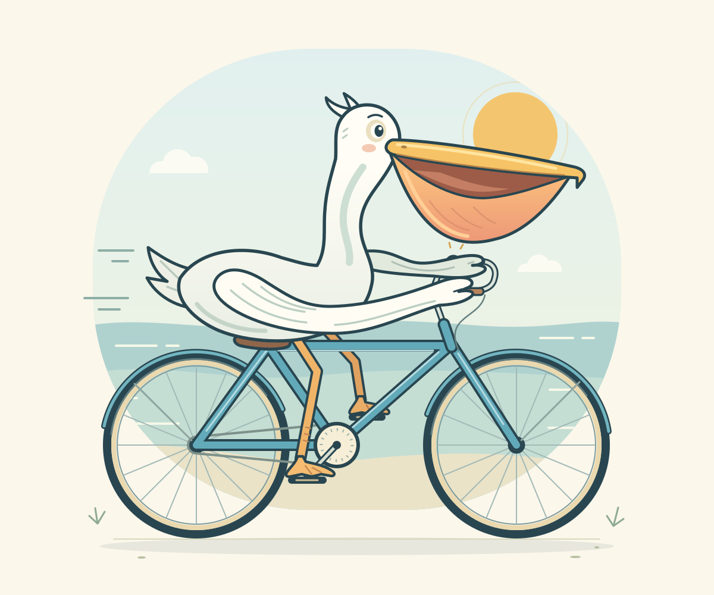</a> | Codex | `gpt-6-astra` | `max` | 用 svg 实现一个鹈鹕骑自行车并且 push |
| 2026-11-14 |  | Codex | `gpt-6.1-sol` | `max` | 使用 svg 生成鹈鹕骑自行车 |
| 2026-11-18 | <a href="./samples/pelican-on-a-bicycle.svg">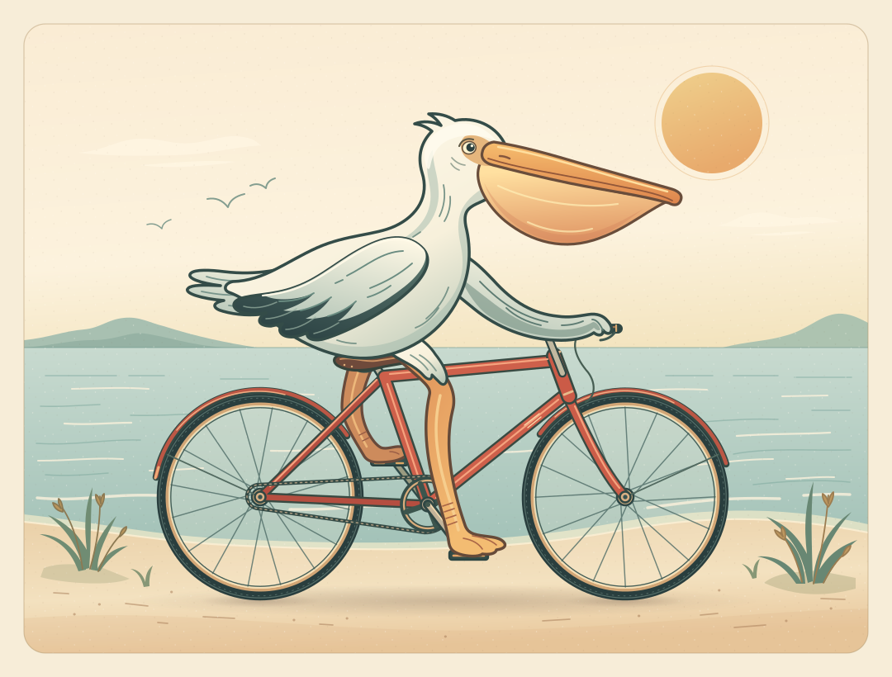</a> | Codex | `gpt-6.2-sol` | `max` | 用 svg 绘制鹈鹕骑自行车。 |
| 2026-11-18 | <a href="./samples/pelican-cycling.svg">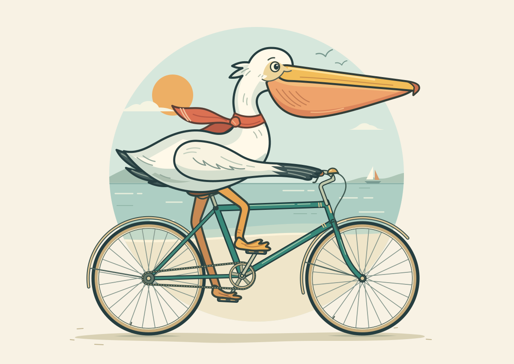</a> | Codex | `gpt-6.2-astra` | `max` | 不要参考以前的内容。 用 SVG 绘制骑自行车的鹈鹕 |
| 2026-11-18 |  | Codex | `gpt-6.2-sol` | `max` | 忽略现有项目参考，使用 6.2 sol 绘制一个 svg 鹈鹕骑自行车。  完成绘制后，极简化整体项目的结构，然后在 readme 中补上之前漏填写上去的 readme.md |

| 生成日期 | SVG 预览 | 调用入口 | 模型 | 推理强度 | 原始提示词 |
| --- | --- | --- | --- | --- | --- |
| 2026-11-19 | <a href="./samples/pelican-bicycle-animation-2026-11-19.svg">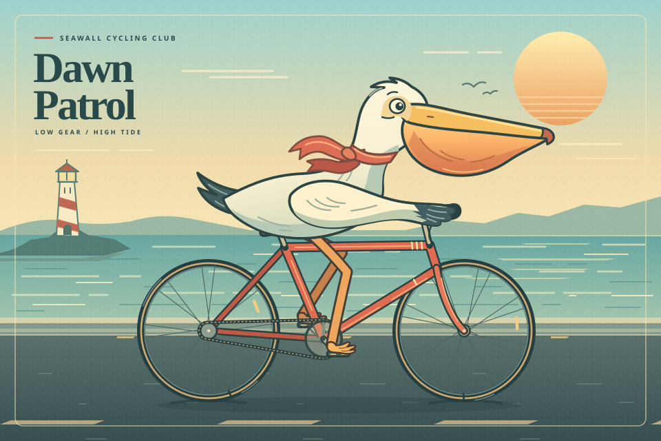</a> | OpenAI API（Pi） | `gpt-6.2-sol` | `max` | 现在我们还需要区分是否是 openAI API 调用的还是 codex 调用的。  现在生成一个鹈鹕骑自行车动画。 |
| 2026-11-23 | <a href="./samples/pelican-bicycle-2026-11-23-claude-opus-5.5.svg">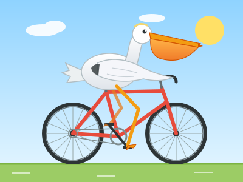</a> | Antigravity | `Claude Opus 5.5` | `high` | /pelican-test |
| 2026-11-23 | <a href="./samples/pelican-bicycle-animation-2026-11-23-claude-opus-5.5.svg">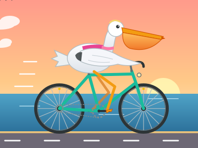</a> | Antigravity | `Claude Opus 5.5` | `high` | /pelican-test animate |
| 2026-11-23 | <a href="./samples/pelican-bicycle-2026-11-23-gemini-4-hydrogen.svg">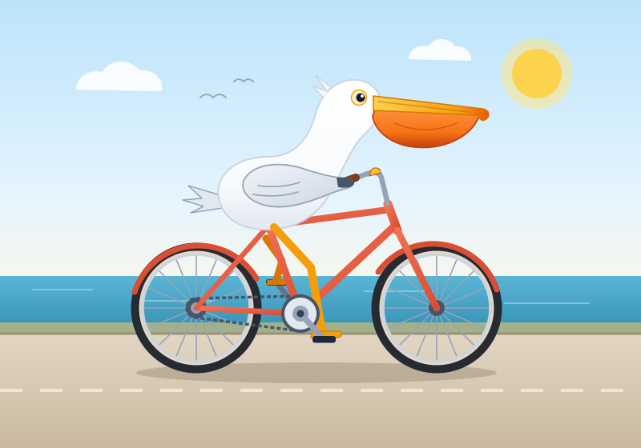</a> | Antigravity | `Gemini 4 Hydrogen` | `medium` | /pelican-test |
| 2026-11-23 | <a href="./samples/pelican-bicycle-2026-11-23-gemini-4-hydrogen-v2.svg">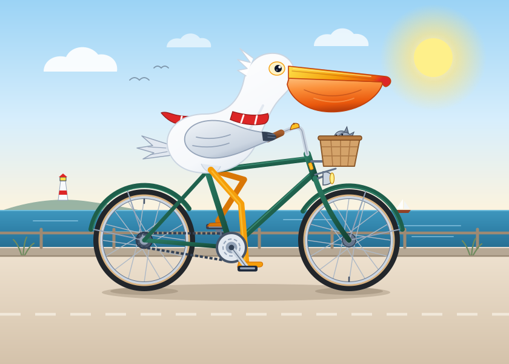</a> | Antigravity | `Gemini 4 Hydrogen` | `xhigh` | /pelican-test |
| 2026-11-25 | <a href="./samples/pelican-bicycle-2026-11-25-gemini-4-carbon.svg">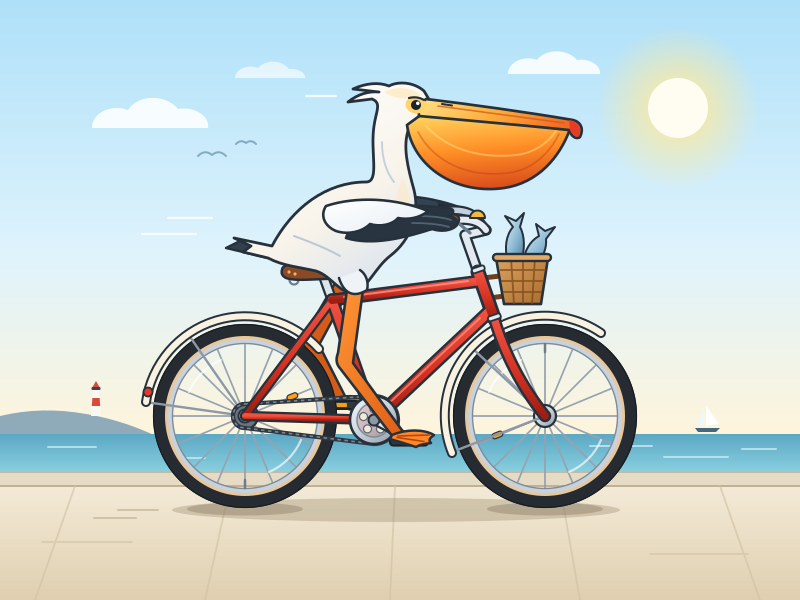</a> | Antigravity | `Gemini 4 Carbon` | `high` | /pelican-test |
| 2026-11-25 | <a href="./samples/pelican-bicycle-animation-2026-11-25-gemini-4-neon.svg"></a> | Antigravity | `Gemini 4 Neon` | `xhigh` | /pelican-test animate |

<strong>Gemini 4 Neon 静态样本（5 项：2026-11-24 ~ 2026-11-25）</strong>

| 生成日期 | SVG 预览 | 调用入口 | 模型 | 推理强度 | 原始提示词 |
| --- | --- | --- | --- | --- | --- |
| 2026-11-24 | <a href="./samples/pelican-bicycle-2026-11-24-gemini-4-neon.svg">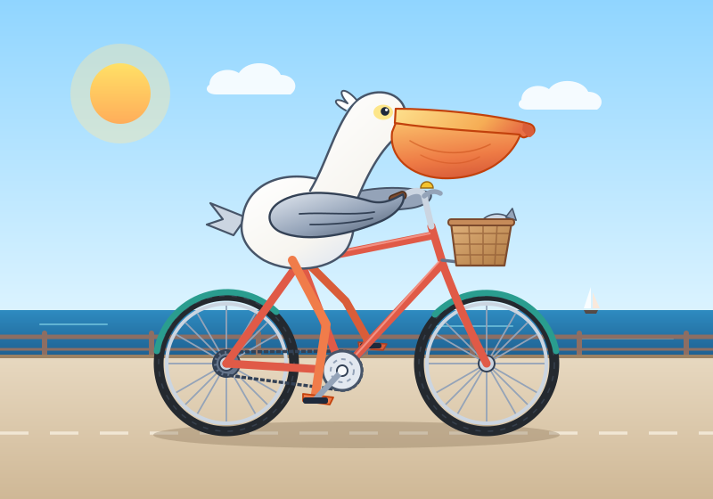</a> | Antigravity | `Gemini 4 Neon` | `medium` | /pelican-test |
| 2026-11-25 | <a href="./samples/pelican-bicycle-2026-11-25-gemini-4-neon-low.svg">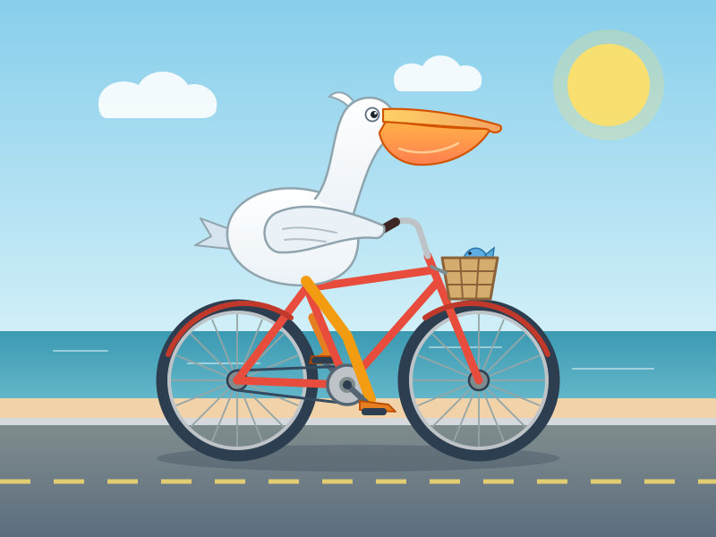</a> | Antigravity | `Gemini 4 Neon` | `low` | /pelican-test |
| 2026-11-25 | <a href="./samples/pelican-bicycle-2026-11-25-gemini-4-neon.svg">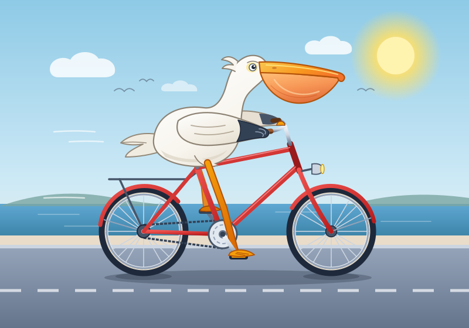</a> | Antigravity | `Gemini 4 Neon` | `medium` | /pelican-test |
| 2026-11-25 | <a href="./samples/pelican-bicycle-2026-11-25-gemini-4-neon-v2.svg">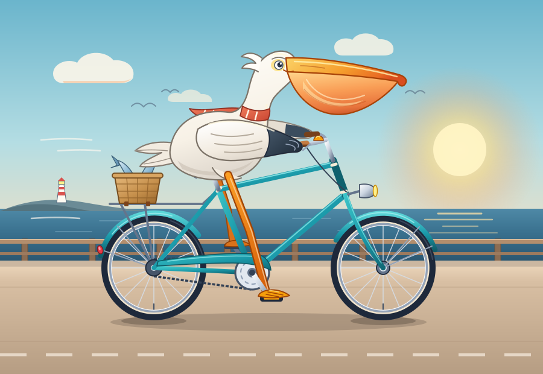</a> | Antigravity | `Gemini 4 Neon` | `xhigh` | /pelican-test |
| 2026-11-25 | <a href="./samples/pelican-bicycle-2026-11-25-gemini-4-neon-v3.svg">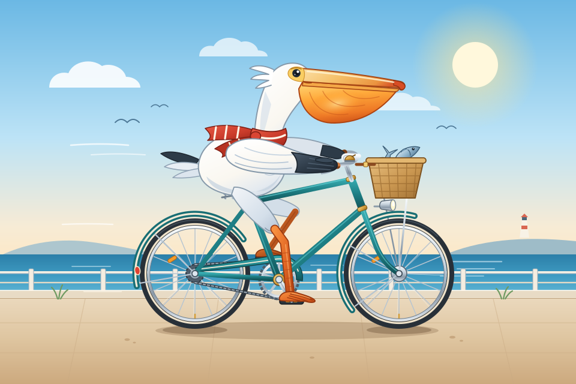</a> | Antigravity | `Gemini 4 Neon` | `xhigh` | /pelican-test |

## 其他测试与提示词（`prompts/`）

| 提示词文件 | 主题与测试内容 | 对应产物 |
| --- | --- | --- |
| [`prompts/melon-jellyy.txt`](./prompts/melon-jellyy.txt) | **Melon Jelly**：原生 WebGPU + WGSL 3D 软体物理西瓜果冻交互模拟（XPBD 体积保持、折射/吸收渲染） | [`melon-jellyy.html`](./melon-jellyy.html) |
| [`prompts/wind-valley-town.txt`](./prompts/wind-valley-town.txt) | **《风之谷物语》**：Three.js + GLSL 治愈系 3D 奇幻小镇（8 栋程序化建筑、动态水车/风车、昼夜变化与电影镜头） | [`3d-samples/wind-valley-town/`](./3d-samples/wind-valley-town/) |
