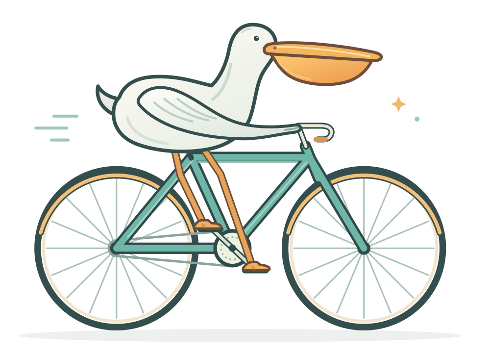

# Yuuki AI 能力测试

保存 AI 在不同日期、模型和版本下完成具体任务的原始结果，方便回看与比较当时的能力。

## 当前样本

| 文件 | 任务 | 生成日期 | 模型 / 版本 | 原始提示词 |
| --- | --- | --- | --- | --- |
| [pelican-bicycle.svg](./pelican-bicycle.svg) | 用 SVG 绘制骑自行车的鹈鹕 | 未记录 | 未记录 | 未记录 |

当前样本保留原文件，不作修改。历史生成信息未知；本次 Git 提交日期仅表示归档时间。

## 后续测试怎么记录

每次新增测试，一并记录：

- 测试日期与时区。
- 使用的产品、模型名称和版本；无法确认时标为未知。
- 完整提示词、输入素材与任务约束。
- 原始输出，以及重试、追问或人工修改次数。
- 人工观察：哪些要求完成了、哪些细节出错、后续对比看什么。

比较模型或日期时，尽量使用相同提示词和约束。新增结果单独保存，保留旧样本供后续对照。

SVG 样本可以直接用浏览器打开，无需安装依赖。
