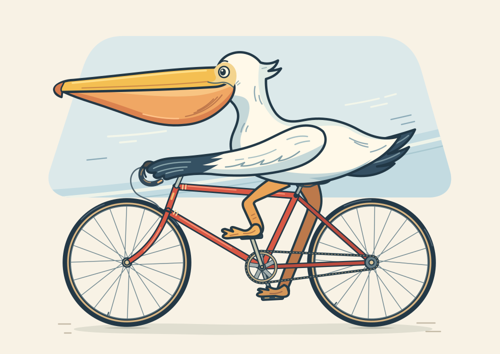

# Yuuki AI 能力测试

保存各模型绘制骑行鹈鹕的原始结果，便于回看与比较。所有 SVG 位于 [samples/](./samples/)，可直接在浏览器打开。日期均为 Asia/Shanghai（UTC+08:00）。



## 样本

| 生成日期 | SVG | Codex 模型 | 推理强度 | 原始提示词 |
| --- | --- | --- | --- | --- |
| 2026-10-27 | [pelican-bicycle.svg](./samples/pelican-bicycle.svg) | `gpt-6.1-terra` | `max` | 画一个鹈鹕自行车svg |
| 2026-10-31 | [pelican-bicycle-2026-10-31.svg](./samples/pelican-bicycle-2026-10-31.svg) | `gpt-6.1-sol` | `max` | 使用 svg 绘制一次鹈鹕自行车，写入当前的日期然后 $push |
| 2026-11-02 | [pelican-bicycle-2026-11-02.svg](./samples/pelican-bicycle-2026-11-02.svg) | `gpt-6-astra` | `max` | 用 svg 绘制一个鹈鹕骑自行车 |
| 2026-11-14 | [pelican-bicycle-2026-11-14.svg](./samples/pelican-bicycle-2026-11-14.svg) | `gpt-6-astra` | `max` | 用 svg 实现一个鹈鹕骑自行车并且 push |
| 2026-11-14 | [pelican-bicycle-2026-11-14-v2.svg](./samples/pelican-bicycle-2026-11-14-v2.svg) | `gpt-6.1-sol` | `max` | 使用 svg 生成鹈鹕骑自行车 |
| 2026-11-18 | [pelican-on-a-bicycle.svg](./samples/pelican-on-a-bicycle.svg) | `gpt-6.2-sol` | `max` | 用 svg 绘制鹈鹕骑自行车。 |
| 2026-11-18 | [pelican-cycling.svg](./samples/pelican-cycling.svg) | `gpt-6.2-astra` | `max` | 不要参考以前的内容。<br>用 SVG 绘制骑自行车的鹈鹕 |
| 2026-11-18 | [pelican-bicycle-2026-11-18-sol.svg](./samples/pelican-bicycle-2026-11-18-sol.svg) | `gpt-6.2-sol` | `max` | 忽略现有项目参考，使用 6.2 sol 绘制一个 svg 鹈鹕骑自行车。<br><br>完成绘制后，极简化整体项目的结构，然后在 readme 中补上之前漏填写上去的 readme.md |

<details>
<summary>样本说明与记录来源</summary>

模型与推理强度来自本机 Codex 会话日志。按写入 SVG 的工具调用核对对应生成轮次的 `turn_context.model` 与 `turn_context.effort`。

| 样本 | 会话 ID 前缀 | 生成轮次 ID 前缀 |
| --- | --- | --- |
| 2026-10-27 原始样本 | `01a17adc` | `01a17adc-732d` |
| 2026-10-31 | `01a191e4` | `01a191ed-c2a8` |
| 2026-11-02 | `01a19ac9` | `01a19ac9-c81f` |
| 2026-11-14 第一版 | `01a1d706` | `01a1d70b-92b8` |
| 2026-11-14 第二版 | `01a1d706` | `01a1d711-5400` |
| `pelican-on-a-bicycle.svg` | `01a1eb19` | `01a1eb19-45c6` |
| `pelican-cycling.svg` | `01a1eb32` | `01a1ec7a-2eb6` |
| `pelican-bicycle-2026-11-18-sol.svg` | `01a1eb32` | `01a1ec94-5009` |

- **2026-10-27** 的日期、模型和提示词来自生成会话，10 月 31 日是首次提交的归档日期。
- **2026-10-31 与 2026-11-02** 均为一次手写 SVG，交付前检查画面，无用户追问或人工修改。前者按上海时区在画面标注日期，后者未使用参考素材。
- **2026-11-14** 两版属于同一会话。第一版参考同一会话生成的位图，预览后修订一次局部线条。第二版重新手写 SVG，使用当时已有的对话上下文，一次绘制完成。两版交付前均检查结构、引用和渲染。
- **11 月 18 日的 `pelican-on-a-bicycle.svg`** 于提交 `82fc87b` 首次归档，模型和原始提示词已根据生成记录补录。
- **11 月 18 日的 `pelican-cycling.svg`** 在用户续接“继续完成测试”后生成，预览后调整踏板位置和自适应视口。关联 PNG 收录于当时的提交。[归档预览](https://github.com/yuukiLike/yuuki-test/blob/13cbc50a815aeed319e884ea113387b794185eff/pelican-cycling-preview.png)
- **本次 Sol 样本《顺风骑行》** 属于连续对话。绘图和浏览器预览在新建临时目录完成，随后读取仓库用于归档。首稿通过 XML、内部引用和渲染检查。

</details>

<details>
<summary>独立复测流程</summary>

1. 新建对话，将工作目录设为仓库外的本机空目录。保持记忆关闭，并固定模型之外的比较条件，包括客户端版本、推理强度、工具、技能、全局指令和检查预算。
2. 发送下面的固定提示词。生成后保存首稿，另存修正版并记录次数。
3. 在另一条对话或由人工归档，补录日期与时区、产品、模型和推理强度的核对来源、完整提示词、输入素材、隔离条件、追问及人工观察。

```text
使用 svg 生成鹈鹕骑自行车，保存为当前目录的 pelican-bicycle.svg。

这是一轮独立测试。不要读取历史对话、记忆、归档仓库或其他测试结果，不要检索已有实现或参考图片。只使用 SVG 矢量元素；可以检查结构并预览本轮产物，记录自行修改次数。完成后停止，由我另行归档。
```

严格隔离应使用只暴露本轮目录和运行依赖的容器或受限环境，并先验证旧文件不可读。Codex 的工作区写入权限和实际读取边界需要分别核对。[官方沙箱说明](https://learn.chatgpt.com/docs/sandboxing#configure-defaults)

</details>
